<!--
  Profile README for github.com/koshal0304
  Everything visual lives in /assets as self-contained animated SVGs (no third-party image services).
  Live stats / 3D skyline / snake are rebuilt by .github/workflows/profile-visuals.yml.
-->

<p align="center">
  
</p>

<p align="center">
  <a href="https://myportfoliodsjfv.netlify.app/"></a>
  <a href="https://linkedin.com/in/koshal-kumar-970233240"></a>
  <a href="mailto:koshalkumar0304@gmail.com"></a>
</p>

<p align="center">
  <a href="#about"><b>About</b></a> &nbsp;·&nbsp;
  <a href="#impact"><b>Impact</b></a> &nbsp;·&nbsp;
  <a href="#experience"><b>Experience</b></a> &nbsp;·&nbsp;
  <a href="#how-i-build"><b>How I build</b></a> &nbsp;·&nbsp;
  <a href="#featured-projects"><b>Projects</b></a> &nbsp;·&nbsp;
  <a href="#tech-stack"><b>Stack</b></a> &nbsp;·&nbsp;
  <a href="#github-activity"><b>Activity</b></a> &nbsp;·&nbsp;
  <a href="#lets-talk"><b>Contact</b></a>
</p>

## About

<p align="center">
  
</p>

I build **production LLM systems end to end**: RAG pipelines, **LangGraph multi-agent workflows**, schema-aware **NL→SQL engines** and document Q&A, from architecture through deployment. Most of it I've built solo, in stacks that shifted as the problem changed. Right now I'm deep in **evaluation rigor**: eval harnesses and hallucination-rate tracking that separate a demo from a system people can trust.

<table>
  <tr><td><b>Now</b></td><td>AI Engineer @ <a href="https://www.alphabetumtech.com/">Alphabetum Technology</a>, building a multi-agent HRMS platform</td></tr>
  <tr><td><b>Shipping AI since</b></td><td>Jan 2025, across 3 companies (Ripik.ai → Renan → Alphabetum)</td></tr>
  <tr><td><b>Strongest at</b></td><td>Agentic RAG · LangGraph orchestration · NL→SQL with guardrails · LLM evals</td></tr>
  <tr><td><b>Based in</b></td><td>Bengaluru, India</td></tr>
  <tr><td><b>Open to</b></td><td>AI Engineer / LLM Engineer roles</td></tr>
</table>

## Impact

<p align="center">
  
</p>

## Experience

<p align="center">
  
</p>

<details>
<summary><b>Read the full experience as text</b></summary>
<br>

**AI Engineer · [Alphabetum Technology](https://www.alphabetumtech.com/)** · *Apr 2026 – Present*
AI-Powered HRMS Platform · Multi-Agent System (LangGraph, FastAPI, PostgreSQL)
- Built a multi-agent AI platform from scratch to automate core HR workflows: recruitment, compensation analytics, an employee co-pilot and workforce simulation.
- Architected a state-machine-driven multi-agent system in LangGraph, modelling 4 HR workflows as DAGs with conditional routing.
- Engineered a schema-aware NL→SQL pipeline producing optimized, read-only PostgreSQL queries with automatic multi-tenant data isolation.
- Implemented RBAC-based access control and prompt-injection detection to protect PII and compensation data at the agent layer.
- Developed a predictive attrition-risk model from weighted behavioural signals (leave patterns, overtime, salary stagnation) for real-time HR alerts.
- Integrated DistilBERT sentiment analysis with LRU caching, plus an automated document-generation engine (offer letters, appraisals, certificates as PDF/DOCX).

**AI Engineer · [Renan](https://www.renan.one/)** · *May 2025 – Mar 2026*
AI Product Engineer · Analytics Platform (LangChain, Azure OpenAI, RAG, LangGraph)
- Owned the AI feature roadmap solo, end to end from architecture to production.
- **RAG metadata enrichment:** column recall was stuck at 0.48. Built an LLM-driven auto-labeling pipeline (business context, keyword patterns, analytical intent) with zero manual annotation and lifted recall to **0.81 (+69%)**.
- **SQL validation pipeline:** 4-stage engine (syntax → semantic → intent → execution) combining LLMs, SQLGlot and Metabase, with context-aware auto-correction, separate rule sets for PostgreSQL and MongoDB, and guardrails against destructive operations.
- **Clarification agent:** detects vague queries and responds with contextual summaries, SQL explanations and smart follow-ups; session caching cut redundant API calls.
- **Document Q&A agent:** PDFs, Excel and Word parsed into per-page markdown in S3, tagged with Gemini-generated metadata; a LangGraph agent filters by metadata so answers are grounded in the right source, minimizing hallucinations and token cost.

**Engineering Intern · [Ripik.ai](https://www.ripik.ai/)** · *Jan 2025 – Apr 2025 · Noida*
ML / Backend Intern, Production Systems (PyTorch, AWS, Gemini API): three months, three shipped production systems.
- Parallelized Boto3 + PIL compression pipeline (150 workers) over 10K+ files: **S3 storage cost −60%**, with full audit logging.
- Fine-tuned ResNet18 on a custom 3-class kiln-image dataset: **98% validation accuracy**, shipped with automated sorting and a confusion-matrix view.
- Gemini API image-analysis pipeline (150-thread concurrency) turning 100+ images/day into structured JSON reports: **manual review time −80%**.

</details>

## How I build

<p align="center">
  
</p>

> Every box above is something I've shipped: the clarification agent, metadata-filtered RAG, the 4-stage SQL validator, RBAC + prompt-injection guardrails, and the eval loop that keeps it honest.

## Featured projects

<p align="center">
  <a href="https://www.alphabetumtech.com/"></a>
  <a href="https://www.renan.one/"></a>
  <a href="https://image-retriver12.netlify.app/"></a>
  <a href="https://github.com/koshal0304/personal-knowledge-assistant"></a>
  <a href="https://github.com/koshal0304/Hiring-Assistant"></a>
  <a href="https://github.com/koshal0304/webcamyolodetector"></a>
</p>

| Project | What it is | Links |
|---|---|---|
| **Multi-Agent HRMS** | LangGraph agents for recruitment, compensation, co-pilot and workforce simulation | Production · private |
| **Project Friday** | Clarification agent, NL→SQL with 4-stage validation, document Q&A | Production · private |
| **Semantic Image Search** | CLIP + FAISS over 1000+ images, hybrid text-image scoring, K-means clusters | [Live demo](https://image-retriver12.netlify.app/) |
| **Personal Knowledge Assistant** | RAG chatbot: Gemini, LangChain, BGE embeddings, Pinecone | [Code](https://github.com/koshal0304/personal-knowledge-assistant) · [Live](https://personal-knowledge-assistant-g.streamlit.app/) |
| **TalentScout** | Gemini-powered candidate screening with tech-specific questions and PII hashing | [Code](https://github.com/koshal0304/Hiring-Assistant) |
| **YOLO Vision Pro** | YOLOv8 on ONNX Runtime for images and live webcam | [Code](https://github.com/koshal0304/webcamyolodetector) · [Live](https://webcamyolodetector.vercel.app) |
| **Gemini RTSP Monitor** | RTSP camera capture + Gemini vision for phone-usage detection | [Code](https://github.com/koshal0304/genai) |

## Tech stack

<p align="center">
  
</p>

## GitHub activity

<p align="center">
  
</p>

<p align="center">
  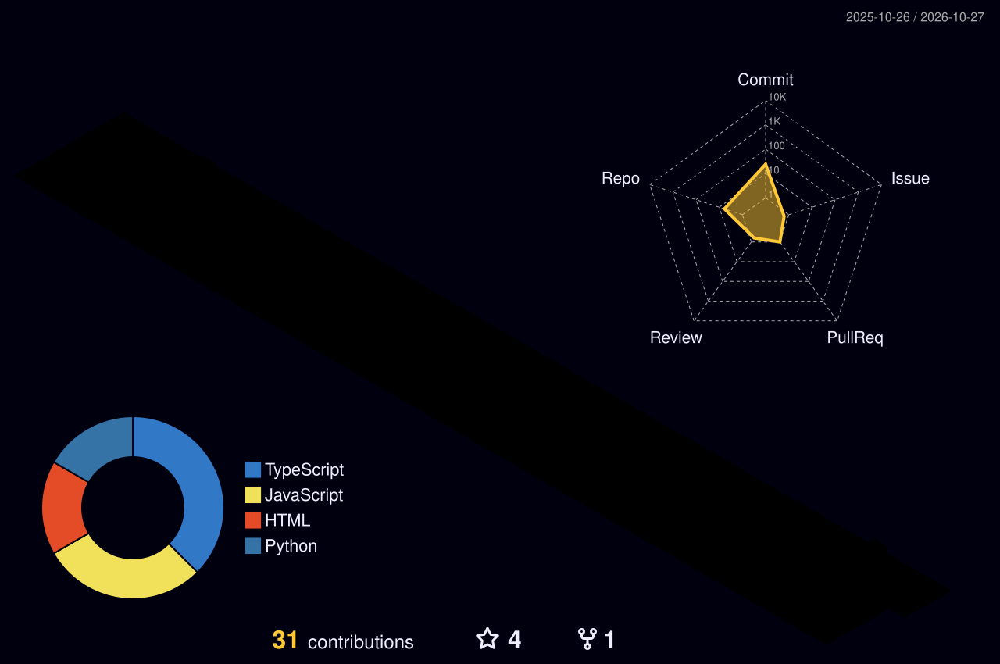
</p>

<details>
<summary><b>Spin my 3D monogram</b>: an interactive STL model that GitHub renders natively (drag to rotate, scroll to zoom)</summary>
<br>

```stl
solid koshal_monogram
  facet normal 0.0000 -0.0000 1.0000
    outer loop
      vertex 7.794 -4.500 1.600
      vertex 7.794 4.500 1.600
      vertex 0.000 9.000 1.600
    endloop
  endfacet
  facet normal 0.0000 0.0000 -1.0000
    outer loop
      vertex 7.794 -4.500 0.000
      vertex 0.000 9.000 0.000
      vertex 7.794 4.500 0.000
    endloop
  endfacet
  facet normal 0.0000 0.0000 1.0000
    outer loop
      vertex 7.794 -4.500 1.600
      vertex 0.000 9.000 1.600
      vertex -7.794 4.500 1.600
    endloop
  endfacet
  facet normal 0.0000 0.0000 -1.0000
    outer loop
      vertex 7.794 -4.500 0.000
      vertex -7.794 4.500 0.000
      vertex 0.000 9.000 0.000
    endloop
  endfacet
  facet normal 0.0000 0.0000 1.0000
    outer loop
      vertex 7.794 -4.500 1.600
      vertex -7.794 4.500 1.600
      vertex -7.794 -4.500 1.600
    endloop
  endfacet
  facet normal 0.0000 0.0000 -1.0000
    outer loop
      vertex 7.794 -4.500 0.000
      vertex -7.794 -4.500 0.000
      vertex -7.794 4.500 0.000
    endloop
  endfacet
  facet normal 0.0000 0.0000 1.0000
    outer loop
      vertex -7.794 -4.500 1.600
      vertex -0.000 -9.000 1.600
      vertex 7.794 -4.500 1.600
    endloop
  endfacet
  facet normal 0.0000 0.0000 -1.0000
    outer loop
      vertex -7.794 -4.500 0.000
      vertex 7.794 -4.500 0.000
      vertex -0.000 -9.000 0.000
    endloop
  endfacet
  facet normal 0.5000 0.8660 0.0000
    outer loop
      vertex 7.794 4.500 0.000
      vertex 0.000 9.000 0.000
      vertex 0.000 9.000 1.600
    endloop
  endfacet
  facet normal 0.5000 0.8660 -0.0000
    outer loop
      vertex 7.794 4.500 0.000
      vertex 0.000 9.000 1.600
      vertex 7.794 4.500 1.600
    endloop
  endfacet
  facet normal -0.5000 0.8660 0.0000
    outer loop
      vertex 0.000 9.000 0.000
      vertex -7.794 4.500 0.000
      vertex -7.794 4.500 1.600
    endloop
  endfacet
  facet normal -0.5000 0.8660 0.0000
    outer loop
      vertex 0.000 9.000 0.000
      vertex -7.794 4.500 1.600
      vertex 0.000 9.000 1.600
    endloop
  endfacet
  facet normal -1.0000 -0.0000 0.0000
    outer loop
      vertex -7.794 4.500 0.000
      vertex -7.794 -4.500 0.000
      vertex -7.794 -4.500 1.600
    endloop
  endfacet
  facet normal -1.0000 -0.0000 0.0000
    outer loop
      vertex -7.794 4.500 0.000
      vertex -7.794 -4.500 1.600
      vertex -7.794 4.500 1.600
    endloop
  endfacet
  facet normal -0.5000 -0.8660 0.0000
    outer loop
      vertex -7.794 -4.500 0.000
      vertex -0.000 -9.000 0.000
      vertex -0.000 -9.000 1.600
    endloop
  endfacet
  facet normal -0.5000 -0.8660 0.0000
    outer loop
      vertex -7.794 -4.500 0.000
      vertex -0.000 -9.000 1.600
      vertex -7.794 -4.500 1.600
    endloop
  endfacet
  facet normal 0.5000 -0.8660 0.0000
    outer loop
      vertex -0.000 -9.000 0.000
      vertex 7.794 -4.500 0.000
      vertex 7.794 -4.500 1.600
    endloop
  endfacet
  facet normal 0.5000 -0.8660 0.0000
    outer loop
      vertex -0.000 -9.000 0.000
      vertex 7.794 -4.500 1.600
      vertex -0.000 -9.000 1.600
    endloop
  endfacet
  facet normal 1.0000 -0.0000 0.0000
    outer loop
      vertex 7.794 -4.500 0.000
      vertex 7.794 4.500 0.000
      vertex 7.794 4.500 1.600
    endloop
  endfacet
  facet normal 1.0000 -0.0000 0.0000
    outer loop
      vertex 7.794 -4.500 0.000
      vertex 7.794 4.500 1.600
      vertex 7.794 -4.500 1.600
    endloop
  endfacet
  facet normal 0.0000 0.0000 1.0000
    outer loop
      vertex -4.100 5.000 5.200
      vertex -4.100 -5.000 5.200
      vertex -2.100 -5.000 5.200
    endloop
  endfacet
  facet normal 0.0000 0.0000 -1.0000
    outer loop
      vertex -4.100 5.000 1.600
      vertex -2.100 -5.000 1.600
      vertex -4.100 -5.000 1.600
    endloop
  endfacet
  facet normal 0.0000 0.0000 1.0000
    outer loop
      vertex -4.100 5.000 5.200
      vertex -2.100 -5.000 5.200
      vertex -2.100 -1.500 5.200
    endloop
  endfacet
  facet normal 0.0000 0.0000 -1.0000
    outer loop
      vertex -4.100 5.000 1.600
      vertex -2.100 -1.500 1.600
      vertex -2.100 -5.000 1.600
    endloop
  endfacet
  facet normal 0.0000 0.0000 1.0000
    outer loop
      vertex -0.900 -0.200 5.200
      vertex 1.700 -5.000 5.200
      vertex 4.100 -5.000 5.200
    endloop
  endfacet
  facet normal 0.0000 0.0000 -1.0000
    outer loop
      vertex -0.900 -0.200 1.600
      vertex 4.100 -5.000 1.600
      vertex 1.700 -5.000 1.600
    endloop
  endfacet
  facet normal -0.0000 0.0000 1.0000
    outer loop
      vertex -0.900 -0.200 5.200
      vertex 4.100 -5.000 5.200
      vertex 0.600 1.400 5.200
    endloop
  endfacet
  facet normal 0.0000 0.0000 -1.0000
    outer loop
      vertex -0.900 -0.200 1.600
      vertex 0.600 1.400 1.600
      vertex 4.100 -5.000 1.600
    endloop
  endfacet
  facet normal 0.0000 0.0000 1.0000
    outer loop
      vertex -0.900 -0.200 5.200
      vertex 0.600 1.400 5.200
      vertex 3.900 5.000 5.200
    endloop
  endfacet
  facet normal 0.0000 0.0000 -1.0000
    outer loop
      vertex -0.900 -0.200 1.600
      vertex 3.900 5.000 1.600
      vertex 0.600 1.400 1.600
    endloop
  endfacet
  facet normal 0.0000 0.0000 1.0000
    outer loop
      vertex -2.100 -1.500 5.200
      vertex -0.900 -0.200 5.200
      vertex 3.900 5.000 5.200
    endloop
  endfacet
  facet normal 0.0000 0.0000 -1.0000
    outer loop
      vertex -2.100 -1.500 1.600
      vertex 3.900 5.000 1.600
      vertex -0.900 -0.200 1.600
    endloop
  endfacet
  facet normal 0.0000 0.0000 1.0000
    outer loop
      vertex -2.100 -1.500 5.200
      vertex 3.900 5.000 5.200
      vertex 1.300 5.000 5.200
    endloop
  endfacet
  facet normal 0.0000 0.0000 -1.0000
    outer loop
      vertex -2.100 -1.500 1.600
      vertex 1.300 5.000 1.600
      vertex 3.900 5.000 1.600
    endloop
  endfacet
  facet normal 0.0000 0.0000 1.0000
    outer loop
      vertex -2.100 -1.500 5.200
      vertex 1.300 5.000 5.200
      vertex -2.100 1.300 5.200
    endloop
  endfacet
  facet normal 0.0000 0.0000 -1.0000
    outer loop
      vertex -2.100 -1.500 1.600
      vertex -2.100 1.300 1.600
      vertex 1.300 5.000 1.600
    endloop
  endfacet
  facet normal 0.0000 0.0000 1.0000
    outer loop
      vertex -4.100 5.000 5.200
      vertex -2.100 -1.500 5.200
      vertex -2.100 1.300 5.200
    endloop
  endfacet
  facet normal 0.0000 0.0000 -1.0000
    outer loop
      vertex -4.100 5.000 1.600
      vertex -2.100 1.300 1.600
      vertex -2.100 -1.500 1.600
    endloop
  endfacet
  facet normal 0.0000 -0.0000 1.0000
    outer loop
      vertex -2.100 1.300 5.200
      vertex -2.100 5.000 5.200
      vertex -4.100 5.000 5.200
    endloop
  endfacet
  facet normal 0.0000 0.0000 -1.0000
    outer loop
      vertex -2.100 1.300 1.600
      vertex -4.100 5.000 1.600
      vertex -2.100 5.000 1.600
    endloop
  endfacet
  facet normal 0.0000 -1.0000 0.0000
    outer loop
      vertex -4.100 -5.000 1.600
      vertex -2.100 -5.000 1.600
      vertex -2.100 -5.000 5.200
    endloop
  endfacet
  facet normal 0.0000 -1.0000 0.0000
    outer loop
      vertex -4.100 -5.000 1.600
      vertex -2.100 -5.000 5.200
      vertex -4.100 -5.000 5.200
    endloop
  endfacet
  facet normal 1.0000 0.0000 0.0000
    outer loop
      vertex -2.100 -5.000 1.600
      vertex -2.100 -1.500 1.600
      vertex -2.100 -1.500 5.200
    endloop
  endfacet
  facet normal 1.0000 0.0000 0.0000
    outer loop
      vertex -2.100 -5.000 1.600
      vertex -2.100 -1.500 5.200
      vertex -2.100 -5.000 5.200
    endloop
  endfacet
  facet normal 0.7348 -0.6783 0.0000
    outer loop
      vertex -2.100 -1.500 1.600
      vertex -0.900 -0.200 1.600
      vertex -0.900 -0.200 5.200
    endloop
  endfacet
  facet normal 0.7348 -0.6783 0.0000
    outer loop
      vertex -2.100 -1.500 1.600
      vertex -0.900 -0.200 5.200
      vertex -2.100 -1.500 5.200
    endloop
  endfacet
  facet normal -0.8793 -0.4763 0.0000
    outer loop
      vertex -0.900 -0.200 1.600
      vertex 1.700 -5.000 1.600
      vertex 1.700 -5.000 5.200
    endloop
  endfacet
  facet normal -0.8793 -0.4763 0.0000
    outer loop
      vertex -0.900 -0.200 1.600
      vertex 1.700 -5.000 5.200
      vertex -0.900 -0.200 5.200
    endloop
  endfacet
  facet normal 0.0000 -1.0000 0.0000
    outer loop
      vertex 1.700 -5.000 1.600
      vertex 4.100 -5.000 1.600
      vertex 4.100 -5.000 5.200
    endloop
  endfacet
  facet normal 0.0000 -1.0000 0.0000
    outer loop
      vertex 1.700 -5.000 1.600
      vertex 4.100 -5.000 5.200
      vertex 1.700 -5.000 5.200
    endloop
  endfacet
  facet normal 0.8774 0.4798 0.0000
    outer loop
      vertex 4.100 -5.000 1.600
      vertex 0.600 1.400 1.600
      vertex 0.600 1.400 5.200
    endloop
  endfacet
  facet normal 0.8774 0.4798 -0.0000
    outer loop
      vertex 4.100 -5.000 1.600
      vertex 0.600 1.400 5.200
      vertex 4.100 -5.000 5.200
    endloop
  endfacet
  facet normal 0.7372 -0.6757 0.0000
    outer loop
      vertex 0.600 1.400 1.600
      vertex 3.900 5.000 1.600
      vertex 3.900 5.000 5.200
    endloop
  endfacet
  facet normal 0.7372 -0.6757 0.0000
    outer loop
      vertex 0.600 1.400 1.600
      vertex 3.900 5.000 5.200
      vertex 0.600 1.400 5.200
    endloop
  endfacet
  facet normal 0.0000 1.0000 0.0000
    outer loop
      vertex 3.900 5.000 1.600
      vertex 1.300 5.000 1.600
      vertex 1.300 5.000 5.200
    endloop
  endfacet
  facet normal 0.0000 1.0000 -0.0000
    outer loop
      vertex 3.900 5.000 1.600
      vertex 1.300 5.000 5.200
      vertex 3.900 5.000 5.200
    endloop
  endfacet
  facet normal -0.7363 0.6766 0.0000
    outer loop
      vertex 1.300 5.000 1.600
      vertex -2.100 1.300 1.600
      vertex -2.100 1.300 5.200
    endloop
  endfacet
  facet normal -0.7363 0.6766 0.0000
    outer loop
      vertex 1.300 5.000 1.600
      vertex -2.100 1.300 5.200
      vertex 1.300 5.000 5.200
    endloop
  endfacet
  facet normal 1.0000 0.0000 0.0000
    outer loop
      vertex -2.100 1.300 1.600
      vertex -2.100 5.000 1.600
      vertex -2.100 5.000 5.200
    endloop
  endfacet
  facet normal 1.0000 0.0000 0.0000
    outer loop
      vertex -2.100 1.300 1.600
      vertex -2.100 5.000 5.200
      vertex -2.100 1.300 5.200
    endloop
  endfacet
  facet normal 0.0000 1.0000 0.0000
    outer loop
      vertex -2.100 5.000 1.600
      vertex -4.100 5.000 1.600
      vertex -4.100 5.000 5.200
    endloop
  endfacet
  facet normal 0.0000 1.0000 -0.0000
    outer loop
      vertex -2.100 5.000 1.600
      vertex -4.100 5.000 5.200
      vertex -2.100 5.000 5.200
    endloop
  endfacet
  facet normal -1.0000 0.0000 0.0000
    outer loop
      vertex -4.100 5.000 1.600
      vertex -4.100 -5.000 1.600
      vertex -4.100 -5.000 5.200
    endloop
  endfacet
  facet normal -1.0000 0.0000 0.0000
    outer loop
      vertex -4.100 5.000 1.600
      vertex -4.100 -5.000 5.200
      vertex -4.100 5.000 5.200
    endloop
  endfacet
endsolid koshal_monogram
```

</details>

## Education

<table>
  <tr><td><b>B.Tech, Automation &amp; Robotics Engineering</b></td><td>Gulzar Group of Institutes, Ludhiana · 2018 – 2022</td></tr>
  <tr><td><b>Certification: Machine Learning</b></td><td>Coding Ninjas</td></tr>
  <tr><td><b>Certification: Data Scientist</b></td><td>AlmaBetter</td></tr>
</table>

## Let's talk

<p align="center">
  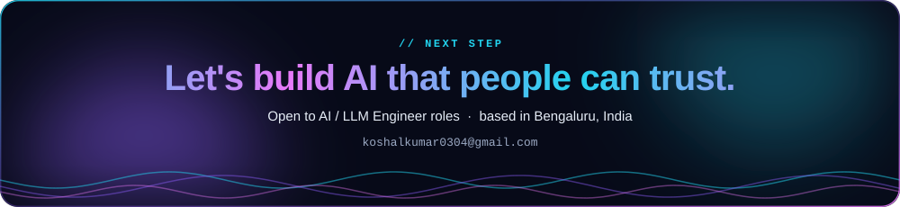
</p>

<p align="center">
  <a href="https://myportfoliodsjfv.netlify.app/"></a>
  <a href="https://linkedin.com/in/koshal-kumar-970233240"></a>
  <a href="mailto:koshalkumar0304@gmail.com"></a>
</p>

<p align="center">
  <picture>
    <source media="(prefers-color-scheme: dark)" srcset="assets/generated/snake-dark.svg">
    <source media="(prefers-color-scheme: light)" srcset="assets/generated/snake-light.svg">
    
  </picture>
</p>
